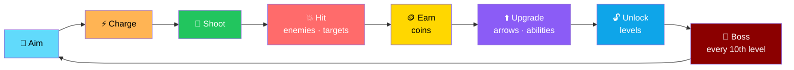

# 🏹 Arrow Master

<div align="center">


**Aim. Charge. Shoot. Master.**

*A 2D archery action game with 100 levels, bosses, upgrades, and procedural art.*

[🚀 Run](#-run) • [🎮 Controls](#-controls) • [✨ Features](#-features) • [🏗️ Architecture](#️-architecture) • [📊 Data-Driven Content](#-data-driven-content)

</div>

---

## 📖 Overview

**Arrow Master** is a **2D archery action game** built with **TypeScript (strict) + Phaser 3 + Vite**.

Aim, charge, shoot, earn coins, upgrade, unlock levels, and defeat bosses.

### Core Idea

> **No external assets needed.**
>
> All graphics are **generated procedurally at startup** and all audio is **synthesized with WebAudio** — so it runs **fully offline** after `npm install`.

### The Loop



---

## 🚀 Run

```bash
npm install
npm run dev        # http://localhost:5173
npm run build      # type-check + production build into dist/
npm run preview    # serve the production build
```

> ✅ **No external assets are needed** — all graphics are generated procedurally at startup and all audio is synthesized with WebAudio.
>
> **Runs fully offline** after `npm install`.

---

## 🎮 Controls

| Action | Desktop | Touch |
|--------|---------|-------|
| **Aim** | Move mouse | Touch + drag |
| **Charge / shoot** | Hold, then release | Hold, then release |
| **Pause** | `ESC` | Pause button |
| **Restart** | `R` | Pause menu |
| **Switch arrow** | `1`–`8` or HUD buttons | HUD buttons |
| **Strafe** | `A` / `D` / arrows | — |
| **Abilities (Armory)** | `Q` Focus, `E` Mend | HUD buttons |

> 📱 **On phones, rotate to landscape.**

### 🛠️ Dev-Only Debug Keys *(`npm run dev` only)*

| Key | Action |
|:---:|--------|
| **`F1`** | Overlay + hitboxes |
| **`N`** | Next level |
| **`W`** | Win |
| **`B`** | Spawn boss |
| **`P`** | Pause |

---

## ✨ Features

<div align="center">

| 🎯 Precision Archery | 🏹 8 Arrow Types |
|:---:|:---:|
| Aim, charge, release — with real physics | Switch on the fly with `1`–`8` |
| **🗺️ 100 Campaign Levels** | **👹 Bosses Every 10th Level** |
| Procedurally validated, data-driven | With abilities — spread, rain, summon, charge |
| **⬆️ Upgrade System** | **🏰 The Armory** |
| Coins earned from every run | Focus (`Q`) and Mend (`E`) abilities |
| **🎮 5 Game Modes** | **🎨 Procedural Art** |
| Campaign · Endless · Time Attack · Precision · Boss Rush | Every sprite is generated at startup |
| **🔊 Synthesized Audio** | **📱 Desktop + Touch** |
| WebAudio — no audio files | Mouse, touch, and HUD buttons |
| **💾 Save System** | **🏆 Achievements & Daily Challenges** |
| Progress, upgrades, and unlocks | Tracked across runs |

</div>

### 🎮 Game Modes

| Mode | Description |
|------|-------------|
| **Campaign** | 100 levels — a boss every 10th |
| **Endless** | Survive and score as long as you can |
| **Time Attack** | Beat the clock |
| **Precision** | Limited arrows — make every shot count |
| **Boss Rush** | Back-to-back boss fights |

> 💡 **Modes are launched from the Level Select screen.**

### 🎨 Optional Real Assets

Put files in **`public/assets/...`** and list them in **`ASSET_MANIFEST`** *(in `src/config/AssetConfig.ts`)*.

> ✅ **Anything that is missing falls back to the built-in procedural art.**

---

## 🏗️ Architecture

### System Overview

```mermaid
flowchart TB
    subgraph CONFIG["⚙️ Config"]
        Constants["game constants"]
        Weapons["weapons / upgrades"]
        EnemyLoader["enemy loader"]
        LevelMgr["LevelManager<br/><em>validation</em>"]
        AssetConfig["AssetConfig<br/>ASSET_MANIFEST"]
    end

    subgraph DATA["📦 Data"]
        Levels["100 level JSONs"]
        Enemies["enemies.json"]
        Bosses["bosses.json"]
        GameData["GameData.ts<br/>achievements · daily challenges"]
    end

    subgraph ENTITIES["🎯 Entities"]
        Archer["Archer"]
        Arrow["Arrow"]
        Enemy["Enemy"]
        Boss["Boss"]
        Target["Target"]
        Projectile["Projectile"]
        Prop["Prop"]
    end

    subgraph SYSTEMS["🧠 Systems"]
        Aim["Aim"]
        Physics["ArrowPhysics"]
        Collision["Collision"]
        EnemySys["Enemy"]
        Wave["Wave"]
        Combo["Combo"]
        Score["Score"]
        Upgrade["Upgrade"]
        PowerUp["PowerUp"]
        Particle["Particle"]
        Background["Background"]
        Audio["Audio"]
        Save["Save"]
        Input["Input"]
        Achieve["Achievement"]
        Services["Services"]
    end

    subgraph SCENES["🎬 Scenes"]
        Boot["Boot"]
        Preload["Preload"]
        MainMenu["MainMenu"]
        LevelSelect["LevelSelect"]
        Game["Game"]
        Pause["Pause"]
        Complete["LevelComplete"]
        Over["GameOver"]
        UpgradeScene["Upgrade"]
        Armory["Armory"]
        Settings["Settings"]
    end

    subgraph UI["🖥️ UI"]
        Button["Button"]
        HUD["HUD"]
        Bars["HealthBar · ProgressBar"]
        Cards["UpgradeCard · LevelCard"]
        Dialog["Dialog"]
    end

    CONFIG --> SCENES
    DATA --> SCENES
    SCENES --> ENTITIES
    ENTITIES --> SYSTEMS
    SYSTEMS --> UI

    style CONFIG fill:#61DAFB,color:#000
    style DATA fill:#22C55E,color:#fff
    style ENTITIES fill:#FFB454,color:#000
    style SYSTEMS fill:#8B5CF6,color:#fff
    style SCENES fill:#FF6B6B,color:#fff
    style UI fill:#0f3460,color:#fff
```



### 📂 Project Layout

```
arrow-master/
├── src/
│   ├── config/       game constants · weapons/upgrades · enemy loader
│   │                 LevelManager (validation)
│   │
│   ├── data/
│   │   ├── levels/   level001..100.json
│   │   ├── enemies/  *.json
│   │   └── GameData.ts   achievements · daily challenges
│   │
│   ├── entities/     Archer · Arrow · Enemy · Boss
│   │                 Target · Projectile · Prop
│   │
│   ├── systems/      Aim · ArrowPhysics · Collision · Enemy · Wave
│   │                 Combo · Score · Upgrade · PowerUp · Particle
│   │                 Background · Audio · Save · Input
│   │                 Achievement · Services
│   │
│   ├── scenes/       Boot · Preload · MainMenu · LevelSelect
│   │                 Game · Pause · LevelComplete · GameOver
│   │                 Upgrade · Armory · Settings
│   │
│   ├── ui/           Button · HUD · HealthBar · ProgressBar
│   │                 UpgradeCard · LevelCard · Dialog
│   │
│   └── utils/        math · physics · random · device
│                     TextureFactory (procedural art)
│
├── tools/
│   └── generate_data.py   regenerates the 100 levels and enemy JSON
│
└── public/
    └── assets/            optional real assets
```

### Design Principles

<div align="center">

| Principle | Implementation |
|-----------|---------------|
| **📊 Levels are data** | 100 validated JSON files — add a new level by dropping a file in `src/data/levels/` |
| **🦹 Enemies are data** | Stats, behavior, colors, and accessory live in `enemies.json` — a texture is generated automatically |
| **👹 Bosses are data** | `bosses.json` with abilities: `spread` · `rain` · `summon` · `charge` |
| **🚫 No crash on bad data** | Invalid levels or unknown enemy types are **skipped with a console warning** |
| **🎨 Everything is procedural** | Every sprite is drawn by `TextureFactory` — no image files needed |
| **🔊 Audio is synthesized** | WebAudio generates every sound — no audio files needed |
| **📱 Touch and desktop are equal** | Mouse, touch, and HUD buttons all work |
| **🔌 Real assets are optional** | Missing assets fall back gracefully to procedural art |
| **🛠️ Dev tools are opt-in** | Debug keys only work with `npm run dev` |
| **🧪 Strict TypeScript** | Build includes a type-check — no `any` shortcuts in the shipped build |

</div>

---

## 📊 Data-Driven Content

> **Adding content requires no engine changes.**

### 🗺️ New Level

**Add `src/data/levels/level101.json`** — same shape as the others.

> ✅ **It is validated and picked up automatically.**

### 🦹 New Enemy

**Add an entry to `src/data/enemies/enemies.json`** with:

- Stats
- Behavior
- Colors
- Accessory

**Reference its key from a level.**

> ✅ **A texture is generated for it automatically.**

### 👹 New Boss

**Add to `bosses.json`** with `abilities` from:

| Ability | Effect |
|---------|--------|
| **`spread`** | Multi-shot |
| **`rain`** | Falling projectiles |
| **`summon`** | Summons minions |
| **`charge`** | Direct rush |

### 🛡️ Validation Behavior

> **Invalid levels or unknown enemy types are skipped with a console warning instead of crashing.**
>
> The game keeps running — bad data never takes the whole game down.

---

## 🗺️ Roadmap

### ✅ Current

- [x] TypeScript strict mode with build-time type-check
- [x] Phaser 3 + Vite setup with fast HMR
- [x] Procedural art generated at startup — no image files
- [x] WebAudio synthesized sound — no audio files
- [x] 100 campaign levels with validation
- [x] Bosses every 10th level with 4 ability types
- [x] 8 switchable arrow types
- [x] Aim, charge, and release with real arrow physics
- [x] Strafe movement on desktop
- [x] Armory abilities — Focus (`Q`) and Mend (`E`)
- [x] Coin rewards and upgrade system
- [x] Combo and scoring systems
- [x] Particle effects and background generation
- [x] Save system with progress, upgrades, and unlocks
- [x] Achievements and daily challenges
- [x] 5 game modes — Campaign, Endless, Time Attack, Precision, Boss Rush
- [x] Full scene flow — Boot, Preload, MainMenu, LevelSelect, Game, Pause, LevelComplete, GameOver, Upgrade, Armory, Settings
- [x] HUD, health bars, progress bars, cards, and dialogs
- [x] Desktop and touch controls
- [x] Optional real assets with graceful fallback
- [x] Dev-only debug keys behind `npm run dev`
- [x] Data-generation tooling — `tools/generate_data.py`

### 🔜 Future Ideas

- [ ] **Additional arrow types** beyond the current 8
- [ ] **New bosses** with new ability types
- [ ] **More game modes** — e.g. daily challenge leaderboard
- [ ] **Boss Rush variants** with modifiers
- [ ] **Local leaderboards** for each mode
- [ ] **Achievement expansion** with more milestone types
- [ ] **Accessibility options** — colorblind palettes, reduced motion
- [ ] **Controller support** via Gamepad API
- [ ] **Audio options** — separate music and SFX volume
- [ ] **Real asset pipeline** — swap procedural for sprite sheets

---

## 🤝 Contributing

Contributions are welcome. Please:

1. Fork the repository
2. **Keep it asset-free by default** — procedural art and synthesized audio are the fallback
3. **Keep levels and enemies in JSON** — `src/data/levels/` and `src/data/enemies/`
4. **Preserve validation** — bad data must warn, not crash
5. **Keep debug keys behind `npm run dev`** — they should never ship
6. **Maintain strict TypeScript** — no `any` in shipped code
7. **Test on desktop and mobile**
8. Submit a Pull Request

### Guidelines

- **Never add a required external asset** — missing assets must fall back gracefully
- **Never break the save format** without a migration path
- **Never ship debug keys** in production builds
- **Never skip validation** when loading level or enemy data
- **Never present a stub as a feature**

---

## 📜 License

MIT — see [LICENSE](LICENSE) for details.

---

## 🙏 Acknowledgments

- **Phaser 3** — for a game framework that stays out of the way
- **Vite** — for dev speed that makes iteration pleasant
- **TypeScript** — for making strict mode a feature, not a burden
- **Every archery game that ever made you hold your breath before a shot** — this one's for you

---

<div align="center">

### 🏹 AIM. CHARGE. SHOOT. MASTER.

**100 levels. 8 arrows. 5 modes. Infinite shots.**

**No external assets. No audio files. Fully offline.**

<br>

⭐ If you enjoyed this game, consider giving it a star.

<br>

[⬆ Back to Top](#-arrow-master)

</div>
